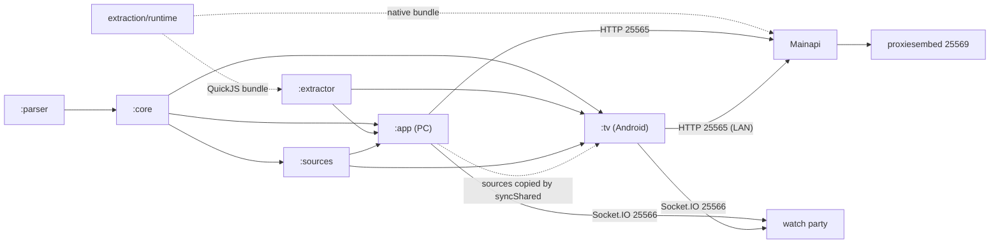

# Architecture

Sokoul is a media centre for films, series, anime and live TV with an Apple TV look. One Kotlin codebase draws the same
Compose screens on a Windows PC (libVLC) and on Android TV and phones (Media3). Optional backend services in `API/`
add accounts, server-side sources, a media proxy and watch parties.

## Repository map

| Path | What it is |
| --- | --- |
| `parser/` | `:parser` — M3U, XMLTV and Xtream parsing, release-title tags. Plain JVM |
| `core/` | `:core` — TMDB, Xtream, IntroDB, Real-Debrid and anime clients, discovery logic. Plain JVM, depends on `:parser` |
| `extractor/` | `:extractor` — host extraction runtime on QuickJS, built from `extraction/runtime` |
| `sources/` | `:sources` — Sokoul's own web-source scrapers (Coflix, French-Stream, PurStream, VoirDrama, Anime-Sama) with a typed result model (`WebSource`, `SourceResult`), shared by the apps and the future Kotlin server. Plain JVM, depends on `:core` and `:extractor` ([README](../sources/README.md)) |
| `app/` | `:app` — the shared screens and the Windows app (Compose Desktop, libVLC); dev tools in `app/src/dev` |
| `tv/` | `:tv` — the Android app (TV and phone): activity, Media3 player, Android counterparts of PC-only files |
| `API/` | Backend services: Mainapi (Node), watch party (Node), proxiesembed (Python) |
| `extraction/` | The canonical extraction runtime, its build scripts and tests ([README](../extraction/README.md)) |
| `openspec/` | Specs and change proposals |
| `docs/` | This documentation |
| `tools/` | Build, install and live-check scripts ([tools.md](tools.md)) |

## One codebase, two platforms

`app/src/main/kotlin` holds every screen. The PC compiles it as is. The Android build copies it into its own source set
(`syncShared` in `tv/build.gradle.kts`), **minus the files that need the desktop JVM** (AWT, Skia, libVLC,
`com.sun.net.httpserver`), and supplies an Android version of each one it needs:

| Concern | PC (`app/`) | Android (`tv/`) |
| --- | --- | --- |
| Entry point | `pc/Main.kt` (window, tray, MCP server) | `tv/MainActivity.kt`, `tv/TvApp.kt` |
| Platform differences | `pc/Platform.kt` | `tv/.../pc/Platform.kt` (recording storage, device caps, image decoding, URLs, phone orientation) |
| Player | `desktop/player/DesktopPlayer.kt` (libVLC via vlcj) | `tv/.../desktop/player/DesktopPlayer.kt` (Media3, curl-impersonate transport) |
| Video surface | `pc/ui/VideoFill.kt` | `tv/.../pc/ui/VideoFill.kt` |
| Local relay, MCP, debug driver | `LocalMediaRelay.kt`, `control/McpServer.kt`, `dev/DebugDriver.kt` | not built |
| TV-only | — | Watch Next row, recording service and wake receiver, accessibility gate, Compose shims |

`Platform.IS_TV` is a compile-time constant (true in the Android build). A file that uses a desktop-only API must be added
to the `syncShared` exclude list and, if Android needs it, given a counterpart under `tv/`.

### Form factors

The Android APK serves TVs and phones. `MainActivity` sets `ui/Form.current` (`FormFactor.Tv`, `PhoneLandscape`,
`PhonePortrait`) from the UI mode, the smallest screen width (< 600 dp is a phone) and the orientation; the PC is
`Desktop`.

- `ui/ScaledRoot.kt` scales the whole interface: on PC and TV one dp is one pixel of a 1920-wide capture; on a phone the
  short side of the screen is 640 dp, so text reads at phone sizes in both orientations.
- `shell/NavShell.kt`: on TV the top bar hides itself (immersive); on a phone it stays. There is no bottom bar: on every form
  factor all navigation is in the top menu behind the avatar/icon.
- The player turns a phone sideways and hides the system bars (`Platform.playerFullscreen`); taps show the controls, a
  double tap on a side skips ±10 s and a horizontal swipe seeks.

## Packages of `:app`

`com.sokoul.pc` holds the screens and their logic; `com.sokoul.desktop` the database, settings, IPTV models and the
player contract (its name predates the TV app).

| Package | Purpose |
| --- | --- |
| `pc` | `App.kt` (navigation between sections and overlays), `AppSetup.kt` (dependency wiring), `Main.kt`, `Platform.kt` |
| `pc.shell` | Navigation shell: top bar and its menu behind the avatar (every form factor) |
| `pc.home` | Home page, rows, screensaver, title alerts |
| `pc.title` | Title page and hero |
| `pc.search` | Search |
| `pc.library` | My List, settings, home rows layout, debrid tools |
| `pc.collections` | Collections, sagas, people |
| `pc.anime` | Anime and manga pages, manga reader |
| `pc.discover` | Discover tools, year review |
| `pc.live` | Live TV: page (`TvScreen`, `TvWorkspace`), programme guide (`Guide*`), providers and channel organisation (`Provider*`, `TvOrganization*`, `TvPersonalization`), logos, sports, reminders, watchlist |
| `pc.playback.session` | Playback session (`PlaybackSession`), models, start clock, stream meter, connection gate, trailers, watch-party sync |
| `pc.playback.sources` | Finding versions: real sources, web and anime sources, embed resolution, subtitles, ranking, debrid |
| `pc.playback.ui` | Player screen, panels, style, navigation rules, live drawers, recording panel, source browser |
| `pc.party` | Watch party rooms and client |
| `pc.startup` | Intro, setup, profiles |
| `pc.data` | Online catalogues (TMDB), profiles, My List, row plans, trailers; `data.anime`, `data.providers` |
| `pc.control` | App bridge and tools (served over MCP on PC) |
| `pc.ui` | Shared components: focus, cards, controls, panels, art, form factor, scaling |
| `pc.theme` | Palette, metrics, type ([design/cartography.md](design/cartography.md)) |
| `pc.i18n` | Interface texts in English and French |
| `pc.dev` | Run-time debug helpers (`DebugDriver`, `FaultSources`, `CutProxy`), active only with `SOKOUL_DEBUG` |
| `desktop.data` | SQLite database, preferences, IPTV sync, debrid, recordings ([data.md](data.md)) |
| `desktop.player` | Player contract and the libVLC player |

`app/src/dev/kotlin` (source set `dev`) holds development tools that never ship: screen renders (`renderScreens`), saga
harvesting, logo and trailer audits, Real-Debrid trials, setup and private-key checks, and the guide render fixture. They
see the main code, internals included.

## Playback flow

1. A screen builds a `PlayRequest` (title, season/episode or live channel) and opens the player overlay (`App.kt`).
2. `PlaybackSession` asks the sources (`playback/sources`) for versions: IPTV provider catalogue, Real-Debrid, Mainapi
   routes, web and anime sources, resolved through the extraction runtime when needed.
3. Versions are ranked (`VersionRanking`, `SourcePreferences`) and the best one starts; the others stay in the versions
   panel.
4. `DesktopPlayer` plays it (libVLC on PC, Media3 on Android); `PlayerScreen` draws the controls, subtitles, skip
   passages and next-episode prompt.
5. Progress is saved per profile (`resume`), and on Android the Watch Next row is refreshed.

## Backend

| Service | Port | Role |
| --- | --- | --- |
| Mainapi | 25565 | Accounts, sync, catalogue and source routes, native extraction |
| proxiesembed | 25569 | Signed media proxy and extraction transport |
| watch party | 25566 | Real-time rooms |

The apps work without the backend (IPTV, Real-Debrid and catalogue features use their own keys); the backend adds server
sources and shared features. See [API/README.md](../API/README.md).

## Remote control and checks

With `SOKOUL_MCP=1` the PC app serves its tools (`control/AppBridge.kt`) over MCP; `SOKOUL_DEBUG=1` enables the debug
driver used by `tools/verify.mjs`. See [testing.md](testing.md).

## Possible next steps

- Replace `syncShared` and its exclude list by a Kotlin Multiplatform module with `jvm` and `android` source sets.
- Rename `com.sokoul.desktop` to a neutral name now that it also serves Android.
- Split `pc.live` (about 30 files) into `guide`, `channels` and `sports`, as was done for `pc.playback`.
